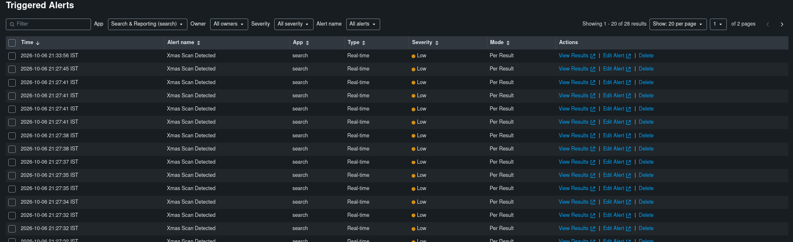
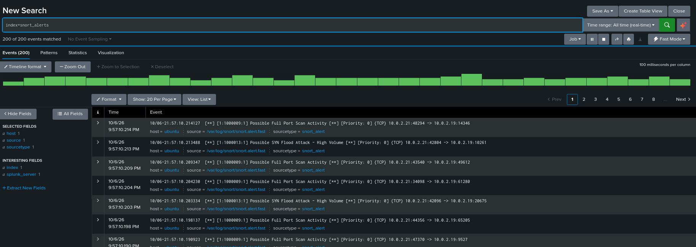
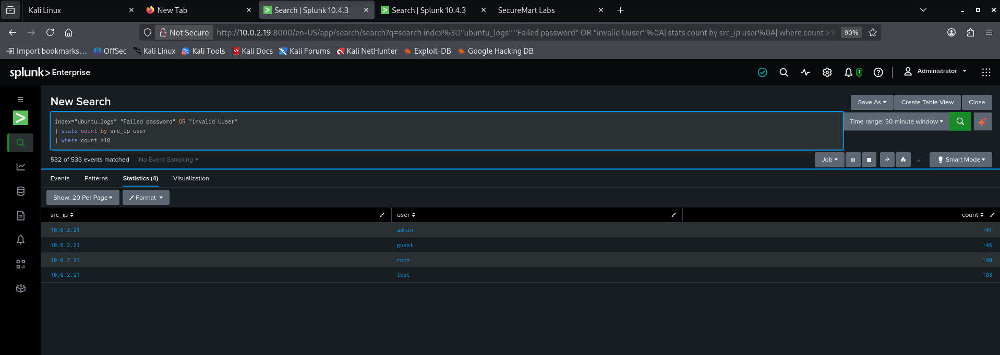
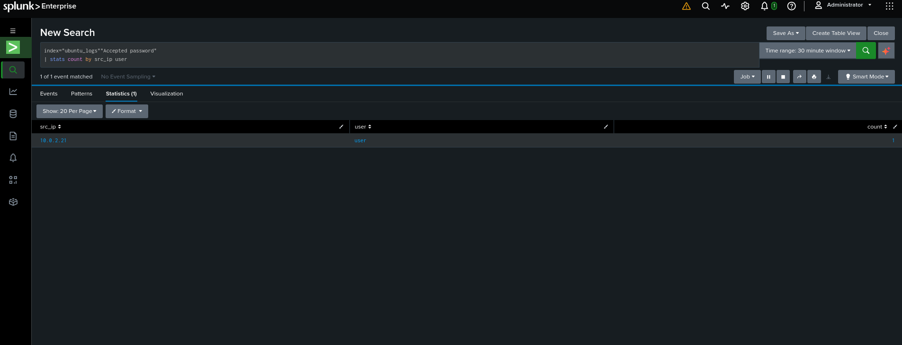
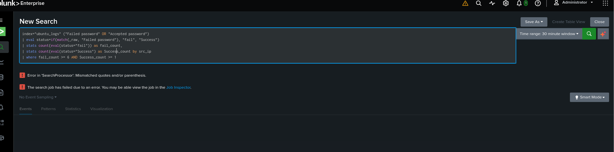
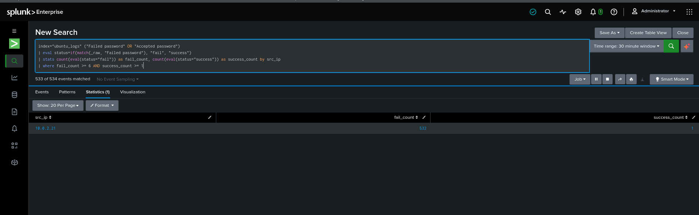
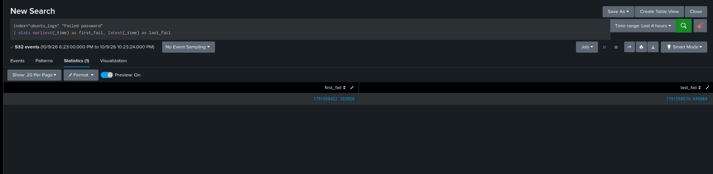

# SOC Incident Report — SSH Brute Force Attack

**Oct 10, 2026 · Goutam Singh Rajput**

## Incident Overview

| Field | Value |
| --- | --- |
| Incident ID | INC-2026-1009-001 |
| Date/Time Detected | 2026-10-09 |
| Analyst | Goutam Singh Rajput |
| Environment | SecureMart Labs (home SOC lab) |
| Severity | High (confirmed compromise) |
| Status | Contained / Under Review |

## Executive Summary

An external source (IP 10.0.2.21) carried out a brute-force attack against the SSH service (port 22) on an internet-facing Ubuntu server, generating 532 failed login attempts within approximately 2 minutes. The attack succeeded — the attacker obtained valid credentials (username: user) and gained unauthorized access. The incident has been detected, and containment is in progress.

## Indicators of Compromise (IOCs)

| Indicator | Value |
| --- | --- |
| Source IP | 10.0.2.21 |
| Destination IP | 10.0.2.19 |
| Destination Port | 22 (SSH) |
| Target Host | Ubuntu Server (SecureMart Labs) |
| Usernames attempted | admin, guest, root, user |
| Successful username | user |
| Attack method | Automated SSH brute-force (consistent with Hydra/Medusa) |

## ATT&CK Mapping

| Field | Value |
| --- | --- |
| Tactic | Credential Access |
| Technique | T1110 (Brute Force) |
| Sub-technique | T1110.001 - Password Guessing |

Applied iteratively across 4 target usernames (admin, guest, root, user), each receiving 100+ password attempts — high-volume per-account guessing rather than low-and-slow password spraying.

## Timeline

| Time (2026-10-09) | Event |
| --- | --- |
| 20:37:02 | First failed login attempt (src 10.0.2.21) |
| 20:37:58 | Successful login — username 'user' compromised |
| 20:38:59 | Last failed login attempt |

Total attack window: ~2 minutes. The brute-force tool continued attempting additional credentials for about a minute after the successful compromise, consistent with automated/unattended tooling (e.g., Hydra) that does not halt on first success.

## Containment Steps

1. Block source IP (10.0.2.21) at the firewall/UFW level to stop further attack traffic.
2. Force a password reset for the compromised account (user); disable the account temporarily if feasible.
3. Review the host for signs of persistence (new SSH keys, new user accounts, cron jobs, unexpected processes) established during the attacker's access window.
4. Enable heightened logging/monitoring on this host for the next 24-48 hours to detect any follow-up activity.
5. If persistence or lateral movement is found, escalate to full host isolation.

## Remediation

- [ ] Disable SSH password authentication; enforce key-based authentication only.
- [ ] Restrict SSH access to a defined allowlist of source IPs or require VPN access for management traffic.
- [ ] Deploy an intrusion-prevention tool (e.g., Fail2Ban or Snort inline blocking) to auto-block repeated failed-login sources.
- [ ] Enforce a strong password policy and remove default/guessable usernames (admin, guest, root, test, user).
- [ ] Enable MFA for SSH where supported.
- [ ] Schedule a recurring review of this detection rule's threshold and false-positive rate.

## Evidence

Splunk screenshots supporting the detection and timeline above.

**Triggered Alerts — background scan activity on the lab**



**Snort alerts — port scan / SYN flood activity from 10.0.2.21 toward 10.0.2.19**



**Failed password attempts by src_ip and user**



**Accepted password — confirmed successful login**



**Correlation query — syntax error (two separate stats commands)**



**Correlation query — corrected, showing fail_count and success_count together**



**Timeline — first and last failed attempt (epoch time)**



## Detection Query (Splunk SPL)

```spl
index="ubuntu_logs" ("Failed password" OR "Accepted password")
| eval status=if(match(_raw, "Failed password"), "fail", "success")
| stats count(eval(status="fail")) as fail_count, count(eval(status="success")) as success_count by src_ip
| where fail_count >= 6 AND success_count >= 1
```

Flags any source IP with 6+ failed SSH logins AND at least one successful login — a high-fidelity signal for "brute-force followed by compromise."
